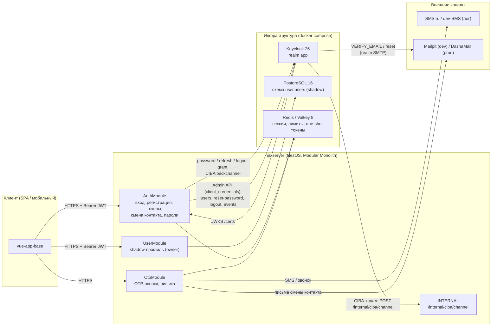
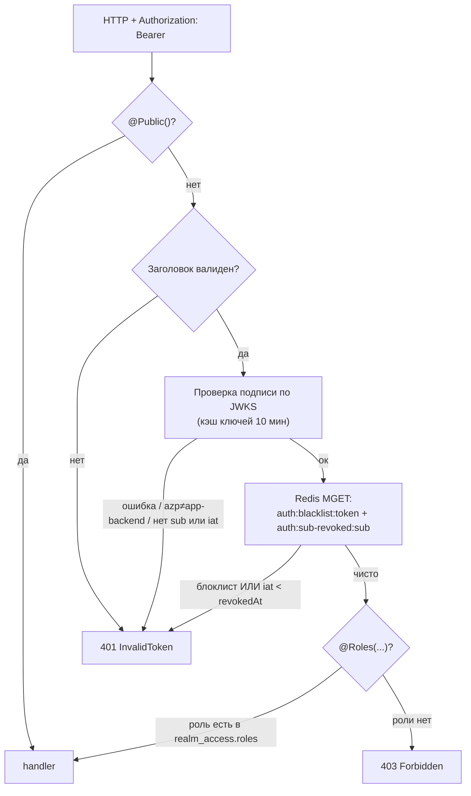
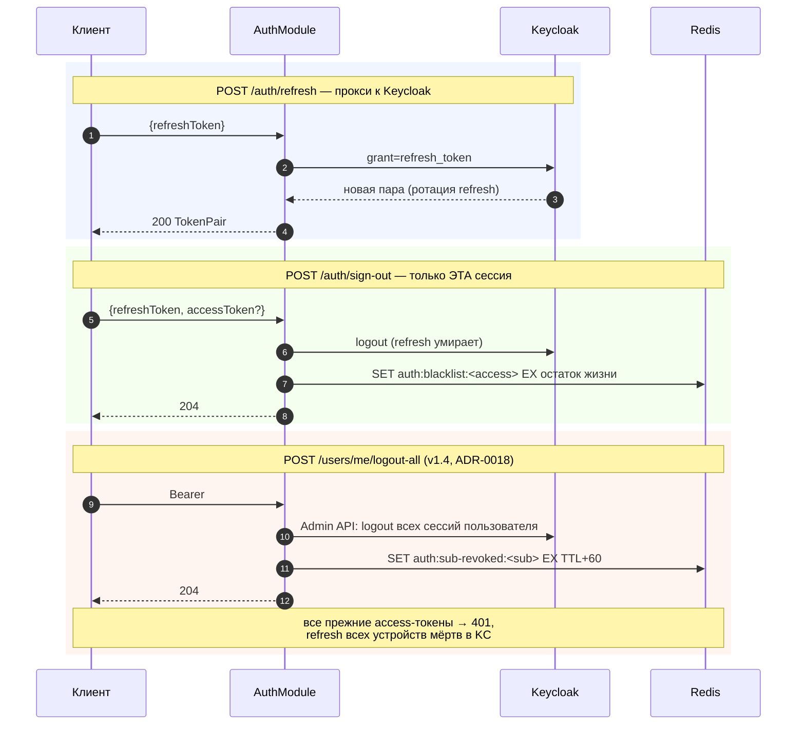
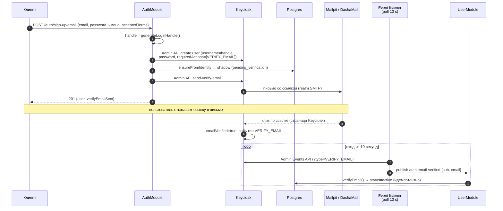
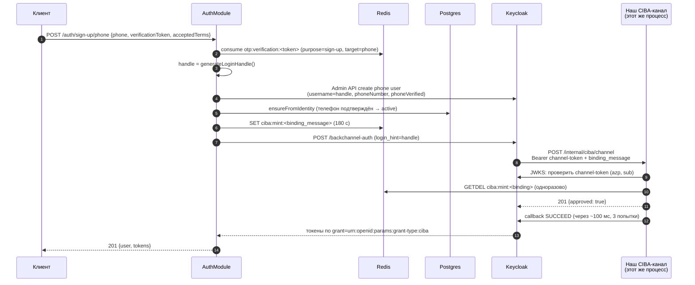
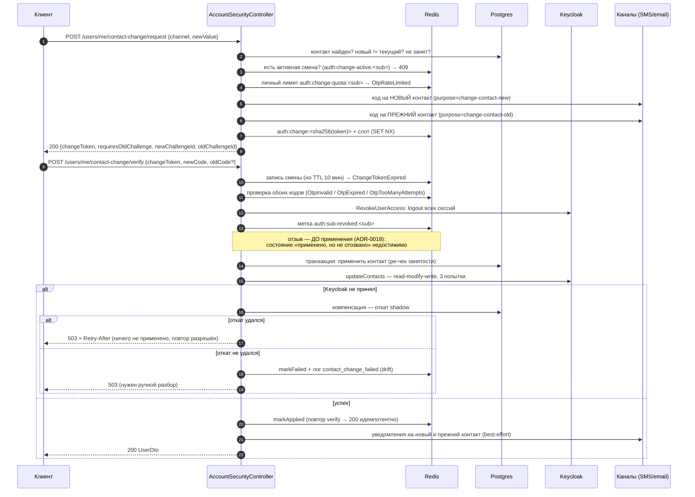
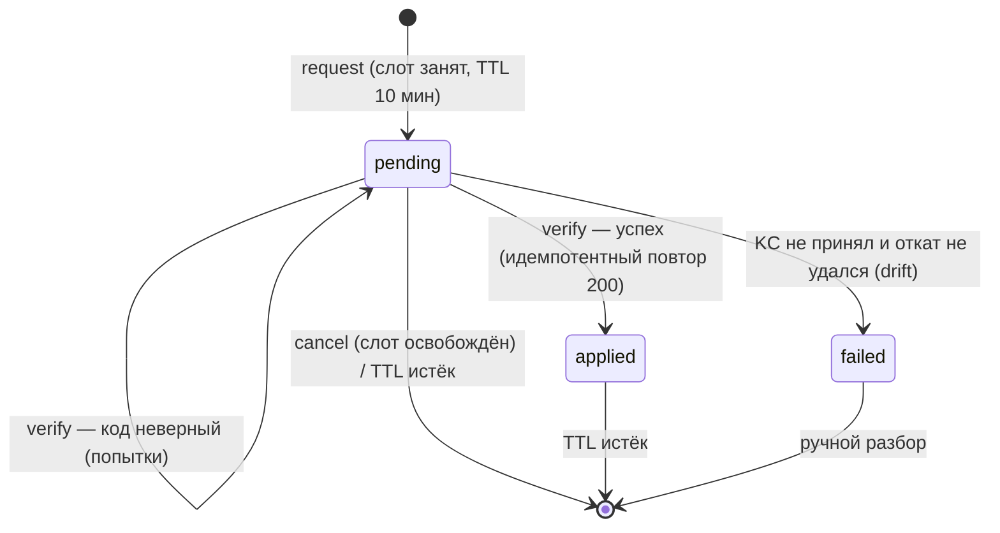
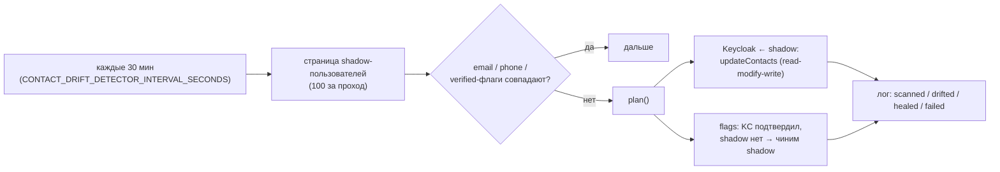

# Взаимодействие приложения с Keycloak, Postgres и Redis (Auth v1)

Как устроены потоки: кто с кем говорит, что где хранится, какие ключи в Redis и в каком порядке идут записи.
Схемы — **Mermaid** (рендерятся в VS Code и на GitHub). Всё сверено с кодом; ссылки на файлы — в конце.

## 1. Кто с кем говорит



| Связь | Протокол | Где в коде |
|---|---|---|
| Клиент → API | HTTPS, `Authorization: Bearer <JWT>` | `JwtAuthGuard` |
| API → Keycloak (пользователь) | OIDC: `password`, `refresh_token`, `logout`, CIBA `backchannel`/`token` | `keycloak-http.client.ts` |
| API → Keycloak (сервис) | Admin REST, токен `client_credentials` (кэшируется) | `shared/infrastructure/keycloak/keycloak-admin.client.ts` |
| API → Keycloak (проверка JWT) | JWKS `/realms/app/protocol/openid-connect/certs` (+ кэш 10 мин) | `keycloak-jwt.verifier.ts` |
| Keycloak → API | CIBA callback на `/api/v1/internal/ciba/channel` (Bearer — channel token) | `ciba-channel.controller.ts` |
| API → Postgres | Prisma 7 (`user.users` — shadow) | `prisma-user.repository.ts` |
| API → Redis | ioredis: отзывы, лимиты, челленджи, one-shot токены | `infrastructure/redis/*` |
| Keycloak → письма | realm SMTP → Mailpit (dev) / DashaMail (prod) | `docker-compose.yml`, `LOCAL_DEV.md` |

## 2. Где какие данные живут

| Данные | Keycloak | Postgres (`user.users`) | Redis |
|---|---|---|---|
| Логин (username = **handle**) | ✅ `username` | ✅ `handle` (копия для резолва) | — |
| Email / телефон | ✅ `email`, атрибуты `phoneNumber`, `phoneVerified` | ✅ `email`, `phone` + метки подтверждения | — |
| Пароль (хеш) | ✅ | ❌ | — |
| Имя/фамилия | ✅ **источник истины** (v1.6) | ✅ копия (sync на входе и при `PATCH /users/me/profile`) | — |
| Роли реалма | ✅ `realm_access.roles` | ✅ копия `roles` (sync на входе) | — |
| Статус (`pending` / `active` / `suspended`) | ❌ | ✅ **источник истины** для бизнес-статуса | — |
| Отозванные access-токены | ❌ (KC не отзывает JWT) | — | ✅ блоклист + метка по `sub` |
| Refresh-сессии | ✅ (гасятся `logout`/`logout-all`) | — | — |
| OTP-коды (хеш Argon2id) | ❌ | — | ✅ челленджи + счётчики лимитов |
| `verificationToken` / `changeToken` / `reauthToken` | ❌ | — | ✅ хеш/one-shot, TTL 10 мин / 10 мин / 5 мин |
| Заявки CIBA-минта | ✅ (auth request) | — | ✅ `ciba:mint:<binding_message>` (180 с) |

> Правило: **контакты и имя** — Keycloak + shadow (пишем в KC, читаем из shadow); **уникальность телефона/email** держит shadow-БД; **статус** живёт только в shadow.

### Ключи Redis (все с TTL)

| Ключ | Значение | TTL | Кто пишет / читает |
|---|---|---|---|
| `auth:blacklist:<token>` | `1` | остаток жизни JWT | `sign-out` → `JwtAuthGuard` |
| `auth:sub-revoked:<sub>` | `floor(now/1000)` | `ACCESS_TOKEN_TTL_SECONDS + 60` | `RevokeUserAccessUseCase` → guard (`iat < revokedAt`) |
| `auth:change:<sha256(token)>` | JSON записи смены | 10 мин | трио `contact-change` |
| `auth:change-active:<sub>` | `sha256(token)` (слот `SET NX`) | 10 мин | одна активная смена на пользователя |
| `auth:change-quota:<sub>` | счётчик смен | сутки | лимит I8 (`OtpRateLimited`) |
| `auth:reauth:<sha256(token)>` | `keycloakId` | 5 мин | `reauth` → guard опасных операций (`GETDEL`) |
| `auth:reauth-fail:<sub>` | счётчик неудач | 15 мин | brute-force на reauth (5 попыток) |
| `otp:challenge:<id>` | снапшот челленджа | срок кода | `otp/send`, `otp/verify`, смена контакта |
| `otp:active:<sha256(target\|purpose)>` | `id` активного челленджа | срок кода | resend/перевыпуск |
| `otp:call:<check_id>` | `id` челленджа | срок кода | обратный звонок (SMS.ru callcheck) |
| `otp:rl:cooldown:<sha256(target)>` | `1` | 60 с | антиспам на цель |
| `otp:rl:target:<sha256(target)>` / `otp:rl:ip:<ip>` | счётчики | 1 час | 3/час на цель, 10/час на IP |
| `otp:verification:<token>` | `{target, purpose}` | 10 мин | `otp/verify` → sign-up/sign-in/set-password |
| `ciba:mint:<binding_message>` | `{loginHint, keycloakId, purpose}` | 180 с | минт → CIBA-канал (`GETDEL`) |

**PII в ключах не пишем**: email/телефон или хешируются (`sha256`), или не попадают в ключ вовсе (`sub`, `challengeId`).

## 3. Вход по email и паролю (`POST /auth/sign-in`)

```mermaid
sequenceDiagram
    autonumber
    participant FE as Клиент
    participant API as AuthController<br/>SignInUseCase
    participant PG as Postgres<br/>(shadow)
    participant KC as Keycloak
    participant BUS as EventBus
    participant U as UserModule<br/>OnUserSignedInHandler

    FE->>API: POST /auth/sign-in {email, password}
    API->>PG: handle по email (PrismaLoginHandleResolver)
    Note over API,PG: логин в KC — handle (путь B),<br/>email в username не уезжает
    API->>KC: POST /token grant=password (client app-backend)
    alt пароль/логин неверны
        KC-->>API: 401 invalid_grant
        API-->>FE: 401 InvalidCredentials
    else успех
        KC-->>API: access + refresh (сессия KC создана)
        API->>KC: JWKS (кэш 10 мин) — проверка подписи/issuer/azp/iat
        API->>KC: Admin API: пользователь по sub (имя; best-effort)
        API->>BUS: publish auth.user-signed-in {sub, email, roles, firstName, lastName}
        BUS->>U: handle(event)
        U->>PG: findByKeycloakId → create (с именем) / sync имени+ролей
        API-->>FE: 200 {accessToken, refreshToken, expiresIn}
    end
```

Ключевое:

- **токены приложение не хранит** — они уходят клиенту, а API проверяет их подпись по JWKS; в Redis лежат только отзывы и лимиты;
- **shadow-запись** создаётся/обновляется по событию (модули не импортируют друг друга);
- имя и роли приходят из Keycloak — это то, что «догоняет» shadow после внешних правок (контракт v1.6).

## 4. Каждый защищённый запрос (guard)



- один `MGET` на запрос (блоклист + метка отзыва) — `redis-token.store.ts`;
- встроенные роли KC (`offline_access`, `uma_authorization`, `default-roles-*`) отфильтровываются;
- `iat < revokedAt` — строгое сравнение: токен, выданный в секунду отзыва, считается свежим входом.

## 5. Жизненный цикл сессии: refresh / выход / «выйти везде»



- выход на одном устройстве **не** убивает остальные — поэтому в `sign-out` нет метки по `sub` (только пер-токенный блоклист);
- `logout-all` — это и есть отзыв доступа: сначала KC (иначе refresh выдаст токен с `iat > revokedAt`), потом Redis; любая ошибка → `503`, метка не ставится.

## 6. Регистрация по email и подтверждение ссылкой



- до подтверждения `POST /auth/sign-in` отвечает **401 `InvalidCredentials`** (анти-энумерация, проверено живьём);
- `POST /auth/verify-email/resend` всегда `202` — существование адреса не раскрывается;
- опрос идемпотентен: повторное чтение события ничего не ломает (дедуп по `time:sub`).

## 7. OTP по SMS (`/auth/otp/*`)

```mermaid
sequenceDiagram
    autonumber
    participant FE as Клиент
    participant API as OtpModule
    participant RD as Redis
    participant PG as Postgres
    participant SMS as SMS.ru / dev-SMS

    FE->>API: POST /auth/otp/send {channel: phone, target, purpose}
    API->>RD: лимиты: cooldown 60 c, 3/час target, 10/час IP
    API->>PG: есть ли такой телефон (CONTACT_LOOKUP)
    alt purpose=sign-up и телефон занят
        API-->>FE: 409 ContactAlreadyExists
    else
        API->>API: код + Argon2id-хеш
        API->>RD: otp:challenge:<id>, otp:active:<hash(target+purpose)>
        opt purpose≠sign-in ИЛИ контакт существует
            API->>SMS: отправка кода
        end
        API-->>FE: 200 {challengeId, mask, expiresAt, ...}
    end

    FE->>API: POST /auth/otp/verify {challengeId, code}
    alt код неверный
        API->>RD: attempts++ (5 → OtpTooManyAttempts)
        API-->>FE: 422 OtpInvalid
    else код верный
        API->>RD: DEL челленджа; SET otp:verification:<token> (10 мин)
        API-->>FE: 200 {verificationToken}
    end
```

- для `purpose=sign-in` ответ **всегда 200**, а SMS не уходит, если номера нет (нельзя узнать, зарегистрирован ли номер);
- `verificationToken` одноразовый (`GETDEL`) и привязан к `target+purpose` — его предъявляют в `sign-up/phone`, `sign-in/phone`, `set-password`;
- коды хранятся **хешем** — дамп Redis не даёт предъявить чужой код.

## 8. Телефон: регистрация и вход через CIBA (ADR-0015)



- «сам себе решатель» не превращается в «выдать токены любому»: подтверждаем только заявку, которую сами создали (`binding_message` из Redis + совпадение `sub`), и заявка одноразовая;
- `login_hint` — **handle**, телефон в Keycloak не уезжает;
- первый минт после простоя медленнее (прогрев KC/CIBA), тёплый — 5–7 с: это пол по `interval` из `backchannel-auth` (см. `LOCAL_DEV.md`).

## 9. Смена контакта: `request` → `verify` (ADR-0017)



Состояния записи смены (`auth:change:<sha256>`):



- вторая попытка `request` при активной смене — `409 ContactChangeAlreadyPending`; штатный перевыпуск кода — **`cancel` → `request`**;
- второй код обязателен, если есть подтверждённый контакт (иначе украденный пароль = захват аккаунта);
- `shadow` — источник правды по контактам, Keycloak приводится к нему; расхождения лечит drift-детектор (§12).

## 10. Пароли: reauth / смена / установка / «забыл»

```mermaid
flowchart TD
    subgraph R["Reauth перед опасной операцией"]
        A1["POST /auth/reauth {password}"] --> A2{"limiter:<br/>5 неудач / 15 мин?"}
        A2 -- нет --> A401a["401 InvalidCredentials"]
        A2 -- да --> A3["handle по sub → password grant в KC"]
        A3 -- "неверный пароль" --> A4["registerFailure → 401"]
        A3 -- "верно" --> A5["reset limiter + logout этой сессии KC"]
        A5 --> A6["Redis auth:reauth:&lt;sha256&gt; (5 мин)"]
        A6 --> A7["X-Reauth-Token для опасных операций"]
    end

    subgraph C["Смена пароля (v1.4)"]
        C1["POST /users/me/password<br/>+ X-Reauth-Token"] --> C2["RevokeUserAccess:<br/>logout всех + метка sub"]
        C2 --> C3["Admin API reset-password"]
        C3 -- "политика KC нарушена" --> C422["422 PasswordPolicyViolation"]
    end

    subgraph S["Установка пароля (phone-пользователь)"]
        S1["POST /users/me/set-password<br/>{verificationToken, newPassword}"] --> S2{"purpose=set-password<br/>и контакт принадлежит мне?"}
        S2 -- нет --> S422["422 VerificationTokenInvalid"]
        S2 -- да --> S3["RevokeUserAccess → set-password в KC"]
    end

    subgraph F["Забыл пароль"]
        F1["POST /auth/forgot-password {email}"] --> F2["лимит по email (всегда 202)"]
        F2 --> F3["Admin API execute-actions-email<br/>UPDATE_PASSWORD (ссылка 1 час)"]
    end
```



Порядок «отзыв → запись пароля» зафиксирован: состояние «пароль изменён, доступ не отозван» недостижимо по построению.
`reauth` при этом не является входом — сессию, созданную проверкой пароля, сразу гасим.

## 11. Профиль: `PATCH /users/me/profile` (v1.6) и sync имени

```mermaid
sequenceDiagram
    autonumber
    participant FE as Клиент
    participant API as UserModule<br/>UpdateMyProfileUseCase
    participant KC as Keycloak
    participant PG as Postgres

    FE->>API: PATCH /users/me/profile {firstName?, lastName?} (Bearer)
    API->>PG: shadow-пользователь по sub → 404 UserNotFound
    Note over API,PG: порядок обязателен: сначала Keycloak
    API->>KC: GET /users/{sub} (текущее представление)
    API->>KC: PUT /users/{sub} — полное представление + новое имя
    alt Keycloak недоступен
        API-->>FE: 503 (shadow НЕ тронут — расхождения нет)
    else успех
        API->>PG: updateProfile + save
        API-->>FE: 200 UserResponseDto
    end
    Note over FE,PG: имя — источник истины Keycloak;<br/>на следующем входе sync (§3) подтвердит значение
```

- `PUT /users/{id}` в Keycloak — **полная замена**: адаптер читает представление и переносит его целиком
  (`username`, `email`, `emailVerified`, `enabled`, `attributes`, `requiredActions`), меняя только имя;
- если shadow-запись упала уже после Keycloak, расхождение лечится синхронизацией на входе — отдельная компенсация не нужна.

## 12. Drift-детектор: периодическая сверка shadow ↔ Keycloak



- источник правды по контактам — **shadow** (уникальность телефона держим мы), поэтому Keycloak приводится к shadow;
- флаги — отдельное правило: «KC подтвердил → shadow тоже подтверждён» (флаги монотонны, `true` выигрывает);
- режим `heal=false` — только отчёт (диагностика), по умолчанию `heal=true`;
- детектор — **долг после Auth v1** (ADR-0017 §3), он не участвует в живом запросе.

## 13. Быстрая карта: эндпоинт → что трогает

| Эндпоинт | Keycloak | Postgres (shadow) | Redis | Внешние |
|---|---|---|---|---|
| `POST /auth/sign-up/email` | admin: create + send-verify | create (pending) | — | Mailpit/DashaMail (KC SMTP) |
| `POST /auth/verify-email/resend` | admin: find + send-verify | — | — | письмо KC |
| `POST /auth/sign-in` | token (password) + admin: имя | upsert (событие) | — | — |
| `POST /auth/refresh` | token (refresh) | — | — | — |
| `POST /auth/sign-out` | logout (refresh) | — | `auth:blacklist:*` | — |
| `POST /auth/forgot-password` | admin: execute-actions | — | лимит по email | письмо KC |
| `POST /auth/otp/send` | — | чтение (занят ли телефон) | челлендж + лимиты | SMS / dev-лог |
| `POST /auth/otp/verify` | — | — | челлендж + `otp:verification:*` | — |
| `POST /auth/phone/call`, `GET .../:id` | — | чтение | челлендж + `otp:call:*` | SMS.ru callcheck |
| `POST /callbacks/smsru` | — | — | `otp:call:*` → подтверждение | — |
| `POST /auth/sign-up/phone` | admin: create phone user | create (active) | `ciba:mint:*` | CIBA-канал, SMS (коды) |
| `POST /auth/sign-in/phone` | CIBA (backchannel + token) | чтение handle | `otp:verification:*`, `ciba:mint:*` | CIBA-канал |
| `POST /internal/ciba/channel` | JWKS + callback SUCCEED | — | `ciba:mint:*` (GETDEL) | — |
| `POST /auth/reauth` | token (password) + logout | чтение handle | `auth:reauth-fail:*`, `auth:reauth:*` | — |
| `POST /users/me/password` | admin: reset-password + logout всех | — | `auth:reauth:*`, `auth:sub-revoked:*` | — |
| `POST /users/me/set-password` | admin: reset-password + logout всех | — | `otp:verification:*`, `auth:sub-revoked:*` | — |
| `POST /users/me/contact-change/request` | — | чтение контактов | челленджи, слот, квота | SMS/email (коды) |
| `POST /users/me/contact-change/verify` | admin: logout всех + updateContacts | транзакция + компенсация | запись смены, метка `sub` | уведомления |
| `POST /users/me/contact-change/cancel` | — | — | освобождение слота | — |
| `POST /users/me/logout-all` | admin: logout всех | — | `auth:sub-revoked:*` | — |
| `GET /users/me` | — | чтение | — | — |
| `PATCH /users/me/profile` | admin: GET + PUT `users/{id}` | update | — | — |
| Админские `/users/*` (create, suspend, activate, delete, contacts) | — | CRUD | — | — |

> Замечание по админским операциям: `suspend` / `delete` в текущем коде меняют **только shadow** и не вызывают
> `RevokeUserAccessUseCase` — то есть уже выданные токены продолжают жить до `exp`. Это не расхождение с контрактом
> (админские эндпоинты вне auth-suite), но при включении их в продукт отзыв нужно добавить (ADR-0018).

## 14. Семантика 503 (когда «ничего не применено»)

| Операция | 503 означает | Заголовок |
|---|---|---|
| `contact-change/verify` | ничего не применено (компенсация удалась), `changeToken` жив — **любой** путь 503 | `Retry-After` (5 с, если есть своё значение, иначе 30 с) |
| `set-password` / `password` | отзыв не выполнен → изменение не применено | — |
| `logout-all` | отзыв не выполнен, метка не поставлена, повтор безопасен | — |
| `PATCH /users/me/profile` | shadow не тронут | — |
| минт токенов (CIBA), звонок, письмо смены контакта | отказ канала/инфраструктуры | — |

Во всех случаях в поле `error` — контрактный код `Service Unavailable` (v1.6), а не текст NestJS «по статусу».

## 15. Где смотреть код

| Тема | Файлы |
|---|---|
| HTTP-слой и маршруты | `modules/*/interfaces/http/*` |
| Вход/выход/токены | `auth/application/use-cases/{sign-in,refresh-token,sign-out,validate-token}`, `auth/infrastructure/keycloak/keycloak.adapter.ts` |
| Проверка JWT и guard | `auth/infrastructure/keycloak/keycloak-jwt.verifier.ts`, `auth/interfaces/http/guards/jwt-auth.guard.ts` |
| Отзыв доступа | `auth/application/use-cases/revoke-user-access`, `auth/infrastructure/redis/redis-token.store.ts` |
| OTP и звонки | `modules/otp/**`, `otp/infrastructure/persistence/redis-otp-challenge.store.ts` |
| CIBA | `auth/application/services/user-token-mint.service.ts`, `auth/infrastructure/keycloak/keycloak-ciba.adapter.ts`, `auth/application/use-cases/handle-ciba-channel-request` |
| Смена контакта | `auth/application/use-cases/{request,verify,cancel}-contact-change`, `auth/infrastructure/redis/redis-change-token.store.ts` |
| Пароли | `auth/application/use-cases/{request-reauth,change-password,set-password,forgot-password}` |
| Профиль (v1.6) | `user/application/use-cases/update-my-profile`, `user/infrastructure/keycloak/keycloak-identity-profile.adapter.ts` |
| Sync имени/ролей | `user/application/event-handlers/on-user-signed-in.handler.ts`, `auth/application/use-cases/sign-in/sign-in.use-case.ts` |
| Drift | `auth/application/services/contact-drift-detector.service.ts` |
| Admin-клиент Keycloak | `shared/infrastructure/keycloak/keycloak-admin.client.ts` (+ `KeycloakAdminModule`) |

ADR: `docs/adr/0015` (phone/CIBA), `0017` (смена контакта), `0018` (отзыв доступа), `0019` (email-канал), `0020` (RBAC).


